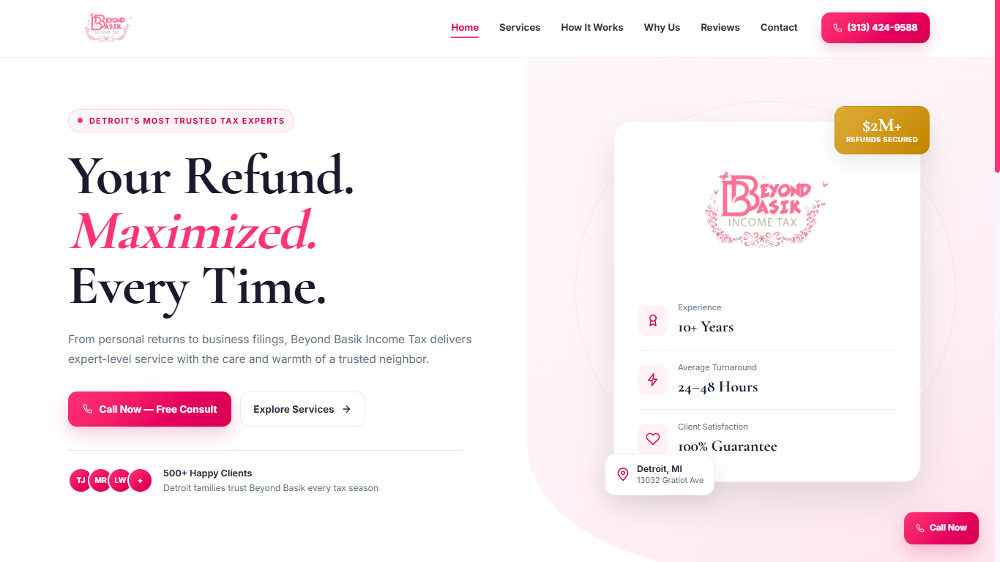
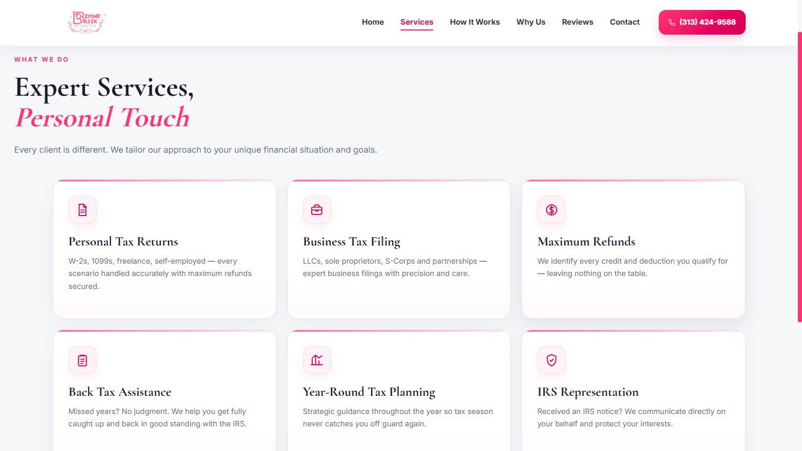
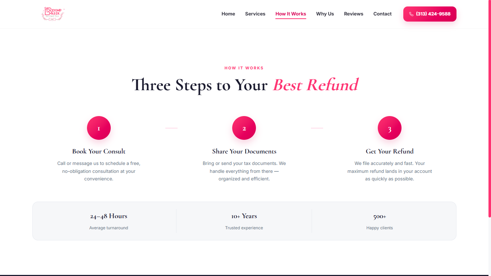
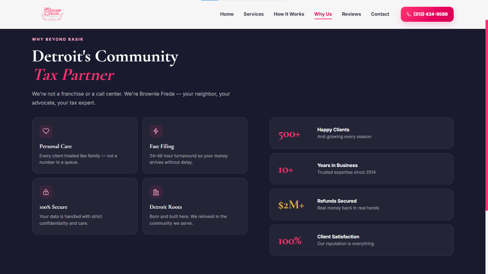
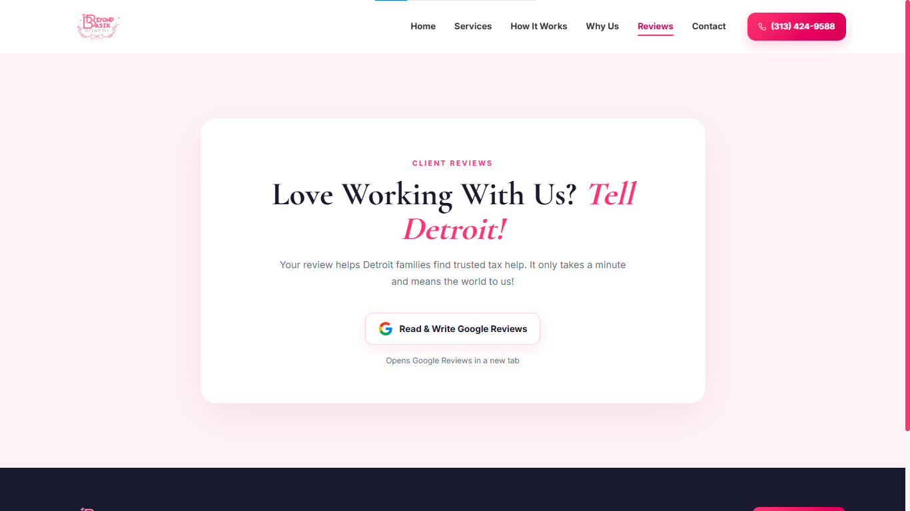
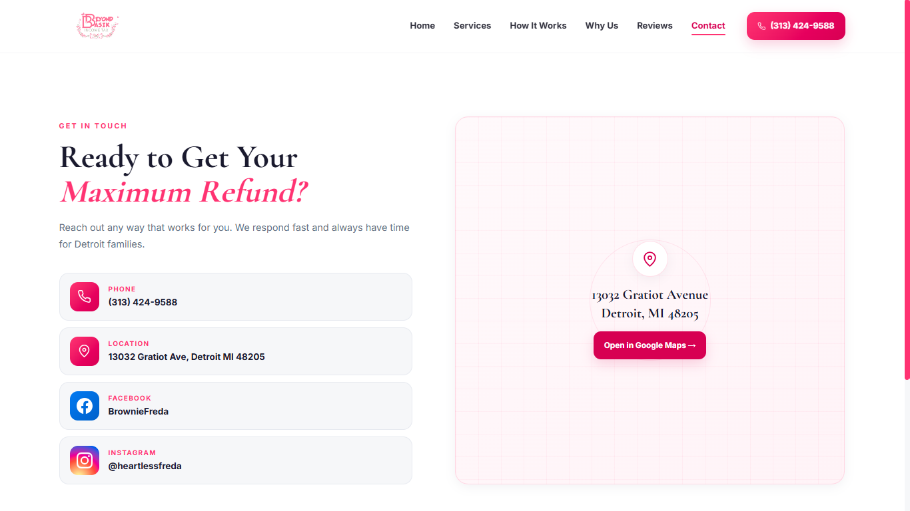

# Beyond Basik Income Tax

**Responsive six-page website for a Detroit-based tax preparation business.** Built with semantic HTML, modern CSS and vanilla JavaScript, with production hosting on Vercel.

**[View the live website](https://beyond-basik-website.vercel.app/)** · **[Explore tax services](https://beyond-basik-website.vercel.app/services)** · **[Contact the business](https://beyond-basik-website.vercel.app/contact)**

## Project overview

Beyond Basik Income Tax needed a clear, approachable web presence that communicates its services and makes it easy for visitors to reach the business. The website uses the client's pink-and-white identity, a consistent navigation system, focused calls to action, and dedicated pages for each main topic.

The website is a **public-facing client project**, not a tax-filing portal. It does not collect tax documents or provide online payment/account functionality.

## Screenshots

Six **authentic desktop captures** of the deployed website, each presented at **1366 × 768 px** for consistent portfolio viewing. Click any image to see the full-size capture. These are not AI-generated UI mockups.

| Home | Tax services |
|:---:|:---:|
| [](screenshots/01-homepage.png) | [](screenshots/02-tax-services.png) |
| **How it works** | **Why Beyond Basik** |
| [](screenshots/03-how-it-works.png) | [](screenshots/04-why-us.png) |
| **Google reviews** | **Contact** |
| [](screenshots/05-google-reviews.png) | [](screenshots/06-contact.png) |

## What the website includes

- **Six dedicated pages:** Home, Services, How It Works, Why Us, Reviews and Contact
- **Responsive layout:** Desktop, tablet and mobile navigation with shared styling
- **Accessible interaction details:** Descriptive controls, visible focus styles, keyboard-dismissable dialogs, and reduced-motion support
- **Service discovery:** Personal returns, business filings, back-tax help, planning and related assistance
- **Direct contact actions:** Click-to-call, business address, map link and social profiles
- **Google Reviews link:** Directs visitors to the business's external Google Reviews page
- **Search/social metadata:** Page titles, descriptions, canonical URLs, Open Graph metadata and structured business information

## Technology

| Layer | Implementation |
|---|---|
| Frontend | HTML5, CSS3, JavaScript (no frontend framework) |
| Interface | Responsive CSS, shared SVG icon sprite and client-provided branding |
| Deployment | Vercel, connected to GitHub `main` |
| Data/backend | Static website; no application database or customer-data backend |

## Site structure

```text
.
├── index.html               # Home
├── services/                # Tax services
├── how-it-works/            # Process overview
├── why-us/                  # Business introduction
├── reviews/                 # Google Reviews call to action
├── contact/                 # Phone, location and social links
├── assets/
│   ├── css/styles.css       # Shared responsive styling
│   ├── js/main.js           # Navigation, interactions and transitions
│   ├── icons/ui.svg         # Shared interface icons
│   └── img/                 # Brand imagery
├── screenshots/             # Real desktop captures for this portfolio
├── robots.txt
└── vercel.json              # Hosting and cache configuration
```

## Run locally

From the repository root, start a basic Python HTTP server:

```powershell
py -m http.server 3000
```

Open **http://localhost:3000**. No `npm install`, database service or API configuration is required to preview the static pages.

## Deployment and maintenance

The production Vercel project follows the GitHub `main` branch. Review changes locally before committing, then verify the resulting production deployment and page behavior on the live domain. The repository is not an admin panel or an online tax-processing application.

## Client and content notes

The website's contact details, branding, reviews destination, and business performance claims are client-provided or client-directed and should be approved by the business before changes. Screenshots document the actual public site. No private client tax records, account credentials or customer database are included in this repository.
